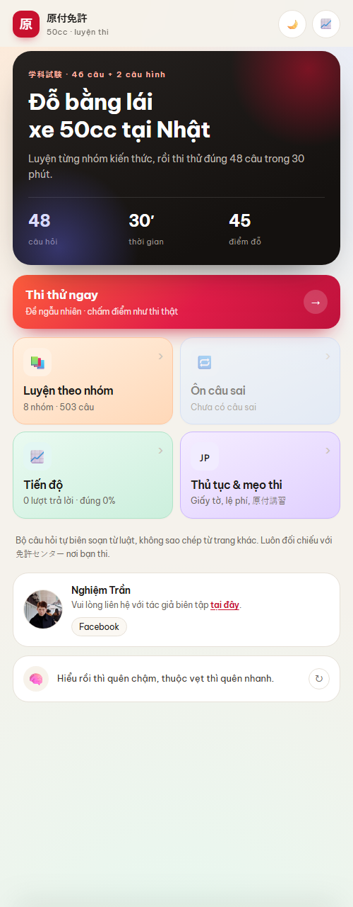

# 原付免許 50cc — App luyện thi bằng lái xe 50cc tại Nhật

Web app tĩnh, không cần server, không cần build. Mở `index.html` là chạy.



## Nội dung

- **503 câu hỏi ○×** tiếng Nhật, chia **8 nhóm**, có giải thích tiếng Việt và căn cứ pháp lý.
- **6 bộ câu hình 危険予測** (mỗi bộ 3 nhận định, đúng cả 3 mới được 2 điểm) — đúng dạng đề thật.
- **Giải thích cả hai đáp án**: vì sao đáp án đúng là đúng, và vì sao đáp án còn lại là sai.
- **Tra từ vựng khi chạm**: 128 từ chuyên ngành, gồm 31 động từ nhận cả dạng chia.
- **Thi thử đúng chuẩn**: 46 câu chữ (1 điểm/câu) + 2 câu hình (2 điểm/câu mỗi câu) = **48 câu, 50 điểm, 45 là đỗ, 30 phút**.
- **Mức sẵn sàng**: dựa trên 5 đề gần nhất, tự báo Đủ / Gần đạt / Chưa.
- **201 câu nói động lực** ngẫu nhiên cuối trang chủ.
- **Giao diện sáng/tối**, tự theo máy lần đầu, có nút chuyển, nhớ lựa chọn.
- **Cài được lên điện thoại** (PWA), chạy offline sau lần mở đầu.
- Tiến độ lưu bằng `localStorage` — chỉ trên máy người dùng, không gửi đi đâu.
- **24 biển báo** vẽ bằng SVG, đã đối chiếu hình mẫu chuẩn.

## Chạy

```
mở trực tiếp: gentsuki-app/index.html
```

Hoặc upload cả thư mục lên hosting tĩnh — xem [DEPLOY.md](DEPLOY.md).

## Cấu trúc

```
gentsuki-app/
├─ index.html
├─ manifest.webmanifest  # khai báo PWA
├─ sw.js                 # service worker — cache offline
├─ icons/                # icon 192/512/maskable/apple-touch
├─ assets/               # ảnh đại diện tác giả
├─ fonts/                # Be Vietnam Pro (woff2, tự host)
├─ DEPLOY.md             # hướng dẫn public + đóng gói Android/iOS
├─ css/
│  ├─ fonts.css          # @font-face
│  └─ style.css          # toàn bộ giao diện + dark mode
├─ js/app.js             # logic, vanilla JS, không build
└─ data/
   ├─ questions.js       # ngân hàng gốc + khai báo 8 nhóm
   ├─ q2.js … q5.js      # các đợt bổ sung
   ├─ q7.js              # luật mới 2025 + kỹ thuật đi xe
   ├─ q8.js, q9.js       # mở rộng lên 503 câu
   ├─ illustrations.js   # 6 bộ câu hình 危険予測
   ├─ traps.js           # "vì sao sai" cho từng câu
   ├─ vocab.js, vocab2.js  # từ điển tra cứu (128 từ)
   ├─ author.js          # credit tác giả
   ├─ quotes.js          # 201 câu động lực
   └─ signs.js           # 24 SVG biển báo
```

## Thêm câu hỏi

Mở `data/q7.js` (hoặc file q*.js bất kỳ), thêm:

```js
{ id: 'x01', cat: 'sign', a: 1,
  q: '「止まれ」の標識がある交差点では、必ず一時停止しなければならない。',
  exp: 'Giải thích vì sao đáp án đúng là đúng.',
  ref: '道路交通法第43条' }
```

Rồi thêm dòng tương ứng vào `data/traps.js`:

```js
x01: 'Vì sao đáp án còn lại là sai.',
```

`cat`: `basic | sign | cross | road | safe | emg | mark | bike`

## Luật mới đã cập nhật

- **新基準原付 (1/4/2025)**: 125cc trở xuống + công suất tối đa 4.0kW → lái bằng bằng 原付; vẫn 30km/h, 二段階右折, 1 người, biển trắng, cấm cao tốc.
- **特定小型原付 (1/7/2023)**: tối đa 20km/h, từ 16 tuổi, không cần bằng, mũ là 努力義務.
- **最低速度** chỉ áp dụng cho 自動車 — 原付 không bị ràng buộc.
- **Đề thi**: 46 câu chữ + 2 câu hình, 50 điểm, 45 đỗ (không phải 50 câu × 1 điểm).

## Nguồn tham khảo

- [高知県警察 – 学科試験上の注意事項](https://www.police.pref.kochi.lg.jp/docs/2023110700484/) (30 phút, 50 điểm, 45 đỗ)
- [ぴよパス – 原付の学科試験の過去問](https://piyopass.com/blog/gentsuki-gakka-renshu-mondai) (cấu trúc 46+2, 出題基準)
- [ぴよパス – 新基準原付](https://piyopass.com/blog/gentsuki-gakka-shinkijun-125cc) (luật 2025)
- [日本二輪車普及安全協会 – ゲンチャレ](https://www.jmpsa.or.jp/genchalle/drill.php) (cấu trúc đề)
- [JAF – 二段階右折](https://jaf.or.jp/common/kuruma-qa/category-bike/subcategory-technic/faq384)
- [Wikipedia – 日本の道路標識](https://ja.wikipedia.org/wiki/日本の道路標識) + [Wikimedia Commons](https://commons.wikimedia.org/wiki/Road_signs_in_Japan) (đối chiếu hình biển)

## Về bản quyền

Toàn bộ câu hỏi được **biên soạn lại** từ luật và các nguồn công khai, không sao chép nguyên văn từ trang luyện thi nào. Hai trang tham khảo ở trên được dùng để đối chiếu **cấu trúc đề và phạm vi kiến thức**, không lấy nội dung câu hỏi.

## Ghi chú kỹ thuật

- Không thư viện ngoài; chạy được cả `file://`.
- Font Be Vietnam Pro tự host (Latin + tiếng Việt), tiếng Nhật dùng font hệ thống.
- `?demo=quiz|answered|exam|ill|examresult|result|stats|practice|ready|word|q&id=s01` để chụp ảnh/giới thiệu.
